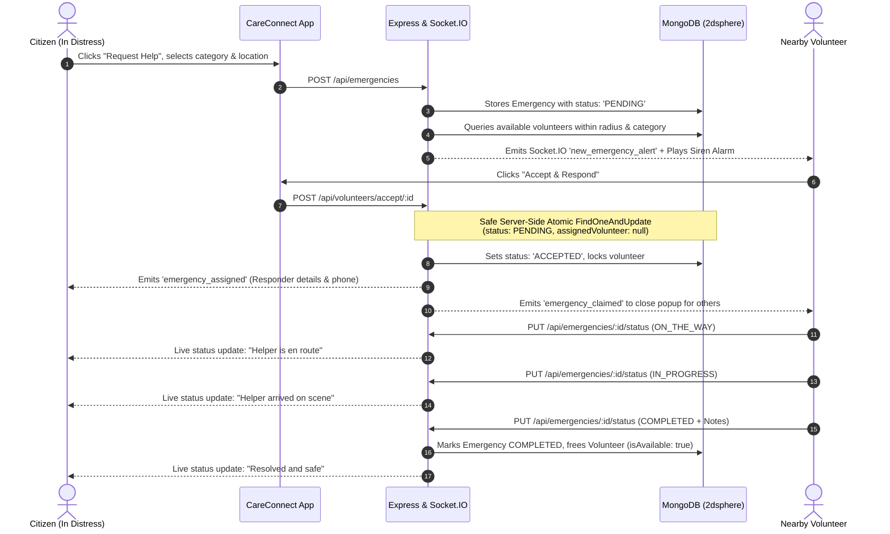

# 🚨 CareConnect – Community-Based Emergency Help Platform

[](https://reactjs.org/)
[](https://socket.io/)
[](https://leafletjs.com/)
[](https://tailwindcss.com/)
[](LICENSE)

**CareConnect** is a full-stack, production-grade community emergency response platform that pairs citizens in urgent distress with certified nearby volunteers, medical first-responders, roadside mechanics, and safety heroes. 

The application minimizes manual intervention through **automated workflows**: automatically querying MongoDB with geospatial algorithms, dispatching real-time WebSocket alerts with audio alarm chimes to matching volunteers within radius, performing atomic race-condition-free assignment, and live tracking responders on interactive OpenStreetMap maps until safety is restored.

---

## 📑 Table of Contents

- [1. System Architecture](#1-system-architecture)
- [2. Technology Stack](#2-technology-stack)
- [3. User Roles](#3-user-roles)
- [4. Automated Emergency Workflow](#4-automated-emergency-workflow)
- [5. Application Pages (All 10 Pages)](#5-application-pages-all-10-pages)
- [6. REST API Endpoints](#6-rest-api-endpoints)
- [7. Geospatial & Real-Time Engine](#7-geospatial--real-time-engine)
- [8. Security Implementations](#8-security-implementations)
- [9. Demo Credentials & Sample Data](#9-demo-credentials--sample-data)
- [10. Quickstart Installation & Execution Guide](#10-quickstart-installation--execution-guide)

---

## 1. System Architecture

```
careconnect/
├── client/                     # Frontend Application (React 18 + Vite)
│   ├── public/
│   ├── src/
│   │   ├── components/
│   │   │   ├── EmergencyMap.jsx        # Interactive Leaflet / OpenStreetMap
│   │   │   ├── Footer.jsx              # Emergency hotlines (112, 108, 100, 101)
│   │   │   ├── IncomingAlertModal.jsx  # Urgent alert popup for volunteers
│   │   │   ├── Navbar.jsx              # Navigation, unread alerts, availability toggle
│   │   │   ├── ProtectedRoute.jsx      # Role authorization guard
│   │   │   └── StatusBadge.jsx         # Color-coded pulsing status indicators
│   │   ├── context/
│   │   │   ├── AuthContext.jsx         # User session, JWT tokens, profile sync
│   │   │   └── SocketContext.jsx       # Bidirectional WebSocket stream & alarms
│   │   ├── pages/
│   │   │   ├── Home.jsx                # Landing hero, rapid SOS CTA, categories
│   │   │   ├── Login.jsx               # Auth + 1-click Demo quick-login buttons
│   │   │   ├── Register.jsx            # Citizen vs. Volunteer tabbed registration
│   │   │   ├── UserDashboard.jsx       # Citizen hub, active case alert, nearby radar
│   │   │   ├── CreateEmergency.jsx     # 4-step emergency dispatch form + map pin
│   │   │   ├── TrackEmergency.jsx      # Live 5-step lifecycle tracker + ETA & route
│   │   │   ├── VolunteerDashboard.jsx  # Dispatch station, online toggle, claim queue
│   │   │   ├── AdminDashboard.jsx      # Analytics KPIs, user directory, case logs
│   │   │   ├── Profile.jsx             # Personal profile, GPS base pin, vehicle setup
│   │   │   └── EmergencyHistory.jsx    # Searchable archive & full audit trail modals
│   │   ├── services/
│   │   │   ├── api.js                  # Axios instance with Bearer interceptors
│   │   │   └── soundAlert.js           # Web Audio API emergency siren synthesizer
│   │   ├── App.jsx                     # Route definitions
│   │   ├── main.jsx                    # Root DOM mounting
│   │   └── index.css                   # Tailwind styles, pulse rings, scrollbars
│   ├── package.json
│   ├── tailwind.config.js
│   └── vite.config.js
│
├── server/                     # Backend Application (Node.js + Express)
│   ├── config/
│   │   └── db.js                       # Mongo connection + zero-config embedded runner
│   ├── controllers/
│   │   ├── authController.js           # Auth, JWT generation, profile management
│   │   ├── emergencyController.js      # Creation, status progression, cancellation
│   │   ├── volunteerController.js      # Safe atomic claim, availability, radar
│   │   ├── adminController.js          # KPI metrics, user activation, audit logs
│   │   └── notificationController.js   # Notification feed & read receipts
│   ├── middleware/
│   │   ├── auth.js                     # JWT verification & role authorization
│   │   └── errorHandler.js             # Mongoose/JWT exception handler
│   ├── models/
│   │   ├── User.js                     # Citizens, Volunteers, Admins
│   │   ├── Volunteer.js                # Categories, availability, 2dsphere coords
│   │   ├── Emergency.js                # Incidents, status timeline, geospatial coords
│   │   └── Notification.js             # Persistent notification logs
│   ├── routes/
│   │   ├── authRoutes.js
│   │   ├── emergencyRoutes.js
│   │   ├── volunteerRoutes.js
│   │   ├── adminRoutes.js
│   │   └── notificationRoutes.js
│   ├── services/
│   │   └── socketService.js            # Real-time rooms, broadcast & location push
│   ├── utils/
│   │   ├── geoUtils.js                 # Haversine distance, ETA, formatting
│   │   └── seed.js                     # Sample database seed generator
│   ├── .env                            # Environment variables
│   ├── package.json
│   └── server.js                       # HTTP server + Socket.IO initialization
│
├── package.json                        # Root workspace scripts
└── README.md
```

---

## 2. Technology Stack

### Frontend
- **React.js 18** (Modern functional components, hooks, Context API)
- **Vite 5** (Ultra-fast build and HMR tooling)
- **Tailwind CSS 3** (Custom emergency color palettes, pulsing rings, responsive layouts)
- **React Router v6** (Nested routes, role-based protection guards)
- **Axios** (REST client with automatic JWT header attachment & 401 handling)
- **Socket.IO Client** (Live duplex communication for alerts, assignments, and tracking)
- **Leaflet & React-Leaflet** (Interactive OpenStreetMap mapping, draggable/clickable pins, route lines)
- **Lucide React** (Crisp vector icons for medical, ambulance, shield, phone, and maps)
- **HTML5 Web Audio API** (Built-in synthesizer alarm without missing external audio files)
- **Browser Notification API** (Native desktop alerts for urgent incidents)

### Backend
- **Node.js 20 & Express.js**
- **MongoDB & Mongoose 8** (Geospatial `2dsphere` indexes, schema validation)
- **Integrated Embedded MongoDB Runner** (`mongodb-memory-server` built-in fallback: starts up immediately even if no local mongod daemon is running!)
- **Socket.IO 4** (Room-based pub/sub for emergency broadcasts and tracker rooms)
- **JWT (JSON Web Tokens)** & **bcryptjs** (Stateless authentication & 10-round salted password hashing)
- **Helmet, CORS, Morgan, Express-Rate-Limit** (Production-ready security hardening)

---

## 3. User Roles

| Role | Key Capabilities |
| :--- | :--- |
| **Normal Citizen (`user`)** | • Create emergency requests across 5 categories.<br>• One-click GPS location detection & interactive map pinning.<br>• Radar view of nearby available volunteers with distance.<br>• Real-time tracking room with live status stepper & responder phone call CTA.<br>• Request cancellation & complete incident history. |
| **Volunteer / Helper (`volunteer`)** | • Specialized registration selecting assistance categories (Medical, Road Accident, Vehicle Breakdown, Fire Emergency, General SOS).<br>• Vehicle configuration (Two-Wheeler, Four-Wheeler, Ambulance, On Foot) and service radius.<br>• Instant Online / Offline availability toggle switch in navigation bar and dashboard.<br>• Real-time modal alert with audio alarm siren whenever a crisis occurs nearby.<br>• Safe atomic acceptance to claim cases.<br>• Live status advancement: "On The Way" ➔ "Arrived at Scene" ➔ "Complete with Notes". |
| **Administrator (`admin`)** | • Real-time operational dashboard with critical KPIs (active cases, fleet size, resolution counts).<br>• Live emergency monitoring table with multi-parameter filtering.<br>• User directory with account activation/deactivation controls.<br>• Complete audit logs and resolution reports. |

---

## 4. Automated Emergency Workflow



> **Fallback Handling**: If no volunteers are immediately within the radius, the system marks the incident as broadcasting, continuously listens for available helpers, and prominently presents **Direct Emergency Hotlines (112, 108, 100, 101, 1091)** with one-click dial buttons.

---

## 5. Application Pages (All 10 Pages)

1. **Home Page (`/`)**: Hero banner with emergency CTA, real-time response counters, 5 crisis category cards, automated pipeline breakdown, and emergency hotlines.
2. **Login Page (`/login`)**: Secure sign-in with **1-click Demo Quick Logins** for Citizen, Doctor, Paramedic, Rescue Mechanic, and Administrator.
3. **Registration Page (`/register`)**: Switch between Citizen and Volunteer; volunteer mode unlocks category checkboxes, vehicle selection, service radius slider, and GPS auto-detect.
4. **User Dashboard (`/dashboard`)**: Citizen control panel displaying active emergency banners, quick SOS CTA, live nearby volunteer radar with distance, and emergency contacts.
5. **Create Emergency Request (`/emergency/create`)**: 4-step dispatch form with category selection, urgency level, situation description, people affected counter, and interactive Leaflet map pin placement.
6. **Track Emergency (`/emergency/track/:id`)**: Real-time incident room with 5-stage stepper (Reported ➔ Assigned ➔ En Route ➔ On Scene ➔ Resolved), responder contact card, interactive map with route line, and audit timeline.
7. **Volunteer Dashboard (`/volunteer/dashboard`)**: Dispatch station featuring an instant Online/Offline toggle, active case progression buttons, and nearby unassigned emergency queue with 1-click claim.
8. **Admin Dashboard (`/admin/dashboard`)**: Executive dashboard featuring KPI statistics, category breakdown charts, live emergency operations table, and user management controls.
9. **Profile Page (`/profile`)**: Update personal details, click on the map to change your default dispatch location, and configure volunteer equipment.
10. **Emergency History (`/history`)**: Searchable archive of all emergency records with status and category filters, and modal view of the full audit trail.

---

## 6. REST API Endpoints

### Authentication (`/api/auth`)
- `POST /api/auth/register` - Register a new user or volunteer
- `POST /api/auth/login` - Authenticate credentials and receive JWT
- `GET /api/auth/profile` - Retrieve authenticated user profile *(Private)*
- `PUT /api/auth/profile` - Update profile, coordinates, or volunteer settings *(Private)*

### Emergencies (`/api/emergencies`)
- `POST /api/emergencies` - Create new emergency & broadcast to nearby helpers *(Private)*
- `GET /api/emergencies` - List emergencies with status/category filters *(Private)*
- `GET /api/emergencies/:id` - Fetch single emergency details with distance/ETA *(Private)*
- `PUT /api/emergencies/:id/status` - Advance status (ON_THE_WAY, IN_PROGRESS, COMPLETED, CANCELLED) *(Private)*
- `DELETE /api/emergencies/:id` - Cancel emergency request *(Private)*

### Volunteers (`/api/volunteers`)
- `GET /api/volunteers/nearby` - Find available volunteers matching coordinates and radius *(Private)*
- `PUT /api/volunteers/availability` - Toggle online/offline status and update location *(Volunteer)*
- `POST /api/volunteers/accept/:id` - Safe atomic assignment of an emergency *(Volunteer)*
- `POST /api/volunteers/reject/:id` - Dismiss an emergency alert *(Volunteer)*
- `GET /api/volunteers/active-emergency` - Fetch currently active assignment *(Volunteer)*

### Administration (`/api/admin`)
- `GET /api/admin/dashboard` - Retrieve system KPI metrics and category statistics *(Admin)*
- `GET /api/admin/users` - Directory of all users with search and pagination *(Admin)*
- `PUT /api/admin/users/:id/status` - Activate or deactivate a user account *(Admin)*
- `GET /api/admin/emergencies` - Complete emergency operations log *(Admin)*

### Notifications (`/api/notifications`)
- `GET /api/notifications` - Retrieve in-app notifications and unread badge count *(Private)*
- `PUT /api/notifications/:id/read` - Mark single notification as read *(Private)*
- `PUT /api/notifications/read-all` - Mark all notifications as read *(Private)*

---

## 7. Geospatial & Real-Time Engine

### Geospatial Calculations
- Volunteer coordinates and emergency incident sites are stored as GeoJSON `Point` objects:
  ```json
  {
    "type": "Point",
    "coordinates": [77.5946, 12.9716] // [Longitude, Latitude]
  }
  ```
- Fast spatial lookups use MongoDB `2dsphere` indexes.
- Distance calculations utilize the spherical **Haversine formula** (`calculateDistanceKm`) providing accuracy in kilometers and meters with dynamic urban vehicle ETA estimates.

### Real-Time Socket.IO Architecture
- **Room Subscriptions**:
  - `user:<userId>`: Direct user notifications and assignment confirmations.
  - `role:volunteer`: Instant broadcasting of incoming emergency alerts.
  - `role:admin`: Live administrative feed of all newly created and updated incidents.
  - `emergency:<emergencyId>`: Private room for real-time status progression and live location updates between requester and assigned helper.
- **Audible Synthesizer**: Web Audio API generates a two-tone emergency siren (850Hz to 600Hz frequency modulation) on incoming alerts.

---

## 8. Security Implementations

1. **Password Hashing**: Salted bcrypt hashing (10 rounds) executed via Mongoose pre-save hooks; plain text passwords are never stored.
2. **Stateless JWT Tokens**: Signed with HMAC SHA256 and configurable expiration (`JWT_EXPIRE=7d`).
3. **Role Authorization Middleware**: Role validation restricts administrative endpoints and volunteer acceptance actions.
4. **Race Condition Prevention**: Safe server-side atomic assignment:
   ```javascript
   const assignedEmergency = await Emergency.findOneAndUpdate(
     { _id: emergencyId, status: 'PENDING', assignedVolunteer: null },
     { $set: { status: 'ACCEPTED', assignedVolunteer: volunteer._id } },
     { new: true }
   );
   ```
5. **Rate Limiting**: `express-rate-limit` enforces a maximum of 300 requests per 15 minutes per IP.
6. **Security Headers**: Helmet configured with relaxed cross-origin resource policies for Leaflet map tiles.

---

## 9. Demo Credentials & Sample Data

When the backend starts, it seeds sample accounts and incidents automatically if the database is fresh:

| Account Type | Email Address | Password | Role / Profile |
| :--- | :--- | :--- | :--- |
| **System Administrator** | `admin@careconnect.org` | `admin123` | Platform Admin |
| **Citizen (Normal User)** | `user@careconnect.org` | `user123` | Requester |
| **Volunteer (Doctor)** | `sarah.medical@careconnect.org` | `volunteer123` | Medical & Ambulance |
| **Volunteer (Paramedic)** | `mike.paramedic@careconnect.org` | `volunteer123` | Road Accident & Rescue |
| **Volunteer (Auto Rescue)**| `rohit.rescue@careconnect.org` | `volunteer123` | Breakdown & Towing |

> **Tip**: On the Login page (`/login`), click any of the **"Instant 1-Click Demo Profiles"** buttons to test all roles immediately without typing credentials!

---

## 10. Quickstart Installation & Execution Guide

### Prerequisites
- Node.js (v18.0.0 or higher)
- npm (v9.0.0 or higher)
- Optional: MongoDB local service or MongoDB Atlas URI (if omitted, CareConnect automatically uses its built-in in-memory MongoDB runner!)

### Step 1: Clone or Navigate to the Project
```bash
cd c:\Users\Praveen\OneDrive\Documents\Projects\careconnect
```

### Step 2: Install Server Dependencies
```bash
cd server
npm install
```

### Step 3: Install Client Dependencies
```bash
cd ../client
npm install
```

### Step 4: Configure Environment Variables
The server includes a pre-configured `.env` file at `server/.env`:
```env
PORT=5000
NODE_ENV=development
JWT_SECRET=careconnect_super_secret_jwt_key_2026_dev_secure
JWT_EXPIRE=7d
MONGO_URI=mongodb://127.0.0.1:27017/careconnect
CLIENT_URL=http://localhost:3000
DEFAULT_SEARCH_RADIUS_KM=15
```
*(If your local MongoDB service is not running, the server automatically starts an embedded in-memory MongoDB runner on demand!)*

### Step 5: Start the Backend Server
```bash
cd server
npm start
```
You should see:
```
 CareConnect Emergency Server Running on Port 5000
 REST API URL: http://localhost:5000/api
 Health Check: http://localhost:5000/api/health
```

### Step 6: Start the Frontend Client (In a New Terminal)
```bash
cd client
npm run dev
```
Open your browser to:
👉 **`http://localhost:3000`**

---

### Step 7: How to Test the Complete End-to-End Workflow

1. **Citizen Request**:
   - Log in as Citizen (`user@careconnect.org` / `user123`).
   - Click the red **"Request Emergency Help"** button.
   - Choose a category (e.g. *Medical Distress*), describe the situation, and click **"Dispatch Request Now"**.
   - You are redirected to the **Live Tracking Room** showing status *Reported (Pending)*.
2. **Volunteer Response (In a Second Browser Window or Incognito)**:
   - Log in as Doctor (`sarah.medical@careconnect.org` / `volunteer123`).
   - Notice the audible alarm siren sound and the prominent **Emergency Alert Nearby** popup!
   - Click **"Accept & Respond"**.
3. **Live Synchronized Updates**:
   - The Citizen's tracking room automatically updates to **"Volunteer Assigned"** with the doctor's name, phone, and ETA!
   - The volunteer clicks **"Start Travel (On The Way)"** ➔ Citizen's stepper advances in real time.
   - The volunteer clicks **"Arrived at Scene"** ➔ Status updates to *Assistance in Progress*.
   - The volunteer clicks **"Resolve & Complete Emergency"** with completion notes ➔ Case is safely resolved and saved into history!
4. **Admin Oversight**:
   - Log in as Admin (`admin@careconnect.org` / `admin123`) to view live KPIs, all emergency logs, and the user management directory.

---

## 🛡️ License

CareConnect is licensed under the **ISC License**. Developed for rapid community crisis response.
